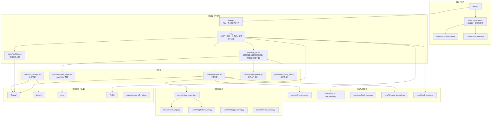
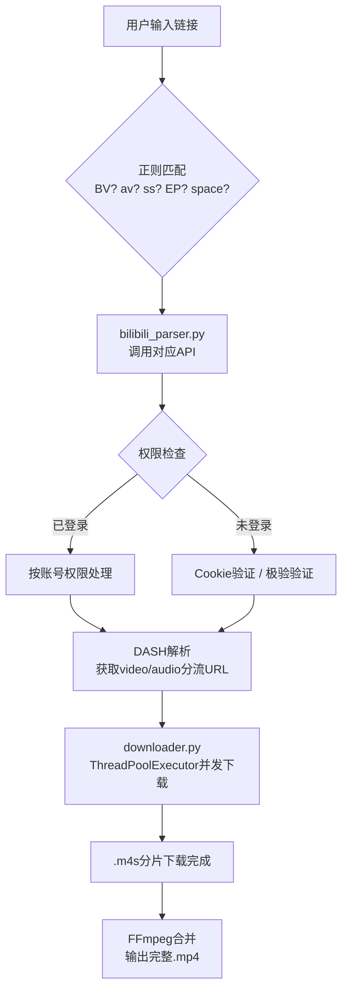
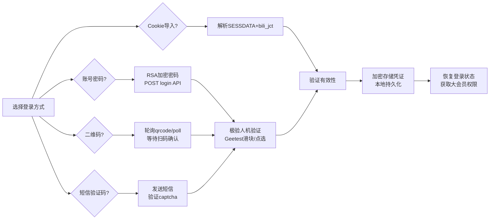
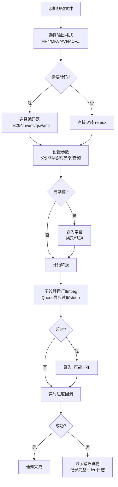

<div align="center">


# B站视频解析下载工具

一款功能强大的B站视频解析与下载工具，支持多种视频类型和下载模式，为用户提供便捷的视频内容获取体验。


<a href='http://www.bilidown.cn'></a>

**当前版本 V2.2.4**

**已获计算机软件著作权登记** · 登记号 `2026SR0955077`

</div>

---

## 软件著作权

本项目已取得中华人民共和国国家版权局签发的《计算机软件著作权登记证书》。

<a href="./assets/copyright/ruanzhu_certificate.png"></a>

---

## 开源许可

本项目采用 [MIT License](./LICENSE) 发布，是符合 [OSI 认证](https://opensource.org/licenses) 的开源软件。

任何人都可以自由使用、修改、分发本项目的源代码，包括商业用途，只需保留原始版权声明。

---

## Code signing policy

Free code signing provided by [SignPath.io](https://about.signpath.io), certificate by [SignPath Foundation](https://signpath.org).

### 隐私政策

This program will not transfer any information to other networked systems unless specifically requested by the user or the person installing or operating it.

详细说明见 [隐私政策](http://www.bilidown.cn/privacy.html)。除用户主动发起的功能外，本程序不会向外部网络传输信息。

本程序使用以下第三方开源组件，它们各自的隐私政策适用于其自身行为：

- [FFmpeg](https://ffmpeg.org/) — 音视频转码与合并（本地运行，不联网）
- [mpv](https://mpv.io/) — 内置播放器（本地运行，不联网）
- [Bento4](https://www.bento4.com/) — DASH 流处理（本地运行，不联网）

---

## 核心功能

### 视频解析与下载

| 能力 | 技术细节 |
|------|----------|
| **链接解析** | 正则匹配 BV号 / av号 / ss号 / EP号 / md号 / UP主空间地址，自动识别类型并路由到对应解析逻辑 |
| **视频类型** | 普通投稿 (ugc) / 番剧 (bangumi) / 合集 (season) / 课堂 (course) / 充电 (pay) / 课程 / Cheese 视频 |
| **清晰度选择** | 360P / 480P / 720P / 1080P+ / 1080P60 / 4K / HDR / Dolby Vision，根据视频实际提供的 DASH 流列表动态生成 |
| **DASH 解析** | 解析 B站 DASH 协议的音视频分片流，支持多 CDN 备选和自动切换 |
| **账号内容** | 支持 Cookie / OAuth 登录，登录后可处理当前账号有权访问的内容 |
| **并发下载** | 基于 `ThreadPoolExecutor` 的可配置并发模型，每个任务独立线程池，互不干扰 |
| **断点续传** | 基于临时文件大小检测 + HTTP Range 请求头实现分段续传，网络中断后自动恢复 |
| **音视频合并** | 内置 FFmpeg，下载完成后自动将分离的视频(.m4s)和音频(.m4s)合并为完整 MP4 |

### 编码与画质

| 能力 | 技术细节 |
|------|----------|
| **GPU 硬件编码** | NVIDIA NVENC (h264_nvenc) / AMD AMF (h264_amf) / Intel QSV (h264_qsv)，启动时自动探测可用 GPU 并回退到 CPU (libx264) |
| **编码格式** | H.264 (AVC) / HEVC (H.265) / AV1 / VP9 / MPEG-4，支持 B站返回的原生编码直出或转码输出 |
| **先下后合模式** | 批量场景下可选：1) 边下边合（传统模式）2) 全部下载完毕后统一合并（减少 FFmpeg 启动开销，提升批量效率） |
| **码率控制** | 自适应 ABR 目标码率（`source × 1.25`，最低 800kbps），CPU/GPU 统一策略；支持复制数据流模式（零转码直接封装） |
| **HDR 支持** | 自动识别 HDR10 / Dolby Vision 元数据，合并时保留色彩空间信息 |
| **未知编码处理** | 对无法识别的视频编码自动降级为 H.264 软解码再编码，避免花屏 |

### 视频工具 (Video Tool)

> V2.0.5 新增模块，V2.0.6 优化关闭稳定性与下拉菜单宽度

| 能力 | 技术细节 |
|------|----------|
| **编码转换** | AV1 (libaom-av1) / HEVC (libx265) -> H.264 (libx264)，解决部分播放器/剪辑软件不兼容新编码的问题 |
| **容器格式** | MP4 / MKV / AVI / MOV / FLV / WebM 容器互转 |
| **分辨率缩放** | `-vf scale=W:H:force_original_aspect_ratio=decrease`，支持指定目标分辨率或按比例缩放 |
| **帧率转换** | `-r N` 参数，支持 24/30/60/120/144 等常见帧率插帧或抽帧 |
| **音频编码** | AAC / MP3 / FLAC / OPUS / WAV / AC3，支持采样率 (8K~48KHz) 和声道 (单声道/立体声) 调节 |
| **比特率控制** | 视频码率和音频码率独立可调 |
| **字幕嵌入** | 支持外挂 SRT/ASS 字幕烧录进视频画面 (`-vf subtitles=`) 或作为独立轨道封装 (`-c:s mov_text`) |
| **元数据写入** | 自定义 title / artist / comment 等 MP4 metadata |
| **硬件加速转换** | 转换过程同样支持 NVENC/QSV GPU 加速，大幅缩短转码时间 |
| **非阻塞 I/O** | 子线程读取 FFmpeg stderr 输出 + Queue 异步通信，UI 不卡顿；超时检测机制防止进程假死 |

### 直播解析

| 能力 | 技术细节 |
|------|----------|
| **他人直播回放** | 支持通过 UID、space 主页链接、直播间号获取主播直播回放列表 |
| **Cookie 同步** | 主程序登录态自动同步到直播解析模块，避免重复登录 |
| **回放下载** | 支持直播回放视频下载，音视频独立下载或合并下载 |

### 登录系统

| 方式 | 技术细节 |
|------|----------|
| **账号密码登录** | POST `https://passport.bilibili.com/web/v2/passport/login`，密码经 RSA 公钥加密传输 |
| **二维码登录** | 轮询 `https://passport.bilibili.com/x/passport-login/oauth2/qrcode/poll` 检测扫码状态 |
| **短信验证码登录** | 发送验证码至绑定手机号，通过 `captcha` 验证后完成登录 |
| **Cookie 导入** | 直接粘贴浏览器 Cookie 字符串，程序解析 SESSDATA 和 bili_jct 并验证有效性 |
| **人机验证** | 登录遇到人机验证时提供验证界面，由用户手动完成验证 |
| **登录态持久化** | 登录凭证加密存储于本地配置文件，重启后自动恢复登录状态 |

### 用户界面

| 组件 | 说明 |
|------|------|
| **主窗口** | 双风格导航（经典 Tab / 侧边栏）：综合下载 / 视频解析 / 弹幕解析 / 收藏夹 / 封面下载 / 下载历史 / 直播 / 表情包 / 音频解析 / 字幕解析 / 系统信息 |
| **悬浮球 (Floating Ball)** | 全局置顶可拖动窗体，右键菜单快速访问：粘贴链接、打开主窗口、显示/隐藏 |
| **任务管理窗口** | 独立窗口展示所有任务队列，支持实时进度条、状态标签颜色区分（进行中/已完成/失败）、滚动位置保持 |
| **任务详情弹窗** | 展示单个任务的完整信息：标题、URL、保存路径、耗时、错误日志、已下载文件列表（支持搜索过滤） |
| **UP主主页解析** | 输入空间 URL -> 调用 `x/space/wbi/arc/search` API -> 卡片式作品列表 -> 多选/全选 -> 批量加入下载队列 |
| **收藏夹解析** | 读取账号收藏列表（含普通/课程/番剧/专栏），卡片化展示，支持搜索和批量操作 |
| **字幕解析** | 解析视频 AI 字幕，时间轴可视化展示字幕时间分布，支持点击/拖动跳转与导出 SRT（V2.1.6 新增） |
| **音频解析** | 歌曲信息 / 音质选择 / 歌词 / 排行榜，可单独下载音频与歌词 |
| **表情包下载** | 解析 B站表情包列表，卡片预览，支持批量下载原图 |
| **主题系统** | 界面配色与布局可自定义，支持导入/导出 `.json` / `.zip` 主题包，内置主题一键切换（V2.2.3） |
| **封面下载** | 从视频信息中提取 cover URL，支持单张或批量下载原图 |
| **综合下载 Tab** | 一站式面板：同时勾选视频 / 弹幕 / 封面 / 字幕，一次点击全部执行 |
| **通知系统** | 基于 `QSystemTrayIcon` 的桌面气泡通知，下载完成/失败/错误时弹出提醒 |
| **窗口层级管理** | 登录框 / 验证码框 / 下载窗口自动设为父窗口的模态子窗口，保证始终浮于主界面之上 |
| **DPI 自适应** | 全局 DPI 缩放策略，高分辨率屏幕下文字和控件不截断、不重叠 |

### 基础设施

| 能力 | 说明 |
|------|------|
| **CLI 模式** | GUI 初始化失败时自动降级为命令行界面 (`bilibilidownloadtool` 命令)，支持无头服务器环境使用 |
| **热更新 (实验性)** | 云端版本比对 -> 下载更新包 -> SHA256 校验 -> 替换文件 -> 重启程序，双轨策略（自建 API 优先 / GitHub Releases 回退） |
| **云端公告** | 从服务器拉取 JSON 格式公告，支持按版本号定向推送（仅特定版本可见），主界面顶部 Banner 展示 |
| **安装/卸载程序** | Windows 安装包（NSIS 风格向导），支持自定义安装路径、创建桌面快捷方式、开始菜单项、覆盖安装保留配置 |
| **WBI 签名** | 实现 B站 WBI (Web Token) 签名算法 `img_key` + `sub_key`，用于访问需要签名的接口 |
| **代理支持** | 配置 HTTP/SOCKS5 代理，解决部分地区访问限制问题 |
| **日志系统** | 基于 Python `logging` 的分级日志框架，输出到文件和控制台，按日期轮转，便于问题排查 |

---

## 项目结构

```text
B站视频解析工具/
├── boot.py                    # 引导入口：先确保 PyQt5 就绪，再拉起主程序
├── boot_bootstrap.py          # 轻量进度窗 + Python 运行时部署（无 PyQt 时用 Tk 兜底）
├── _pathsetup.py              # 把 core/、parsers/ 等子目录注入 sys.path
├── main.py                    # 应用入口：单实例锁、启动窗口、崩溃看门狗、错误弹窗
├── ui.py                      # 主界面(PyQt5)：导航/Tab、对话框、悬浮球、主题系统、视频工具、任务窗口
│
├── core/                      # 核心业务与基础服务
│   ├── downloader.py          # 下载引擎：并发、断点续传、分片、音视频合并
│   ├── task_manager.py        # 任务队列与持久化
│   ├── config.py · app_config.py   # 配置读写
│   ├── download_history.py    # 下载历史
│   ├── filename_template.py   # 文件名模板渲染
│   ├── tool_manager.py        # FFmpeg / Bento4 分发与自愈
│   ├── cloud_service.py       # 云端：更新检查、公告、日志上报、反馈
│   ├── cert_installer.py      # 证书安装（减少杀软误报）
│   ├── icon_manager.py        # 图标资源管理
│   ├── env_checker.py         # 运行环境检测
│   ├── pyqt5_bootstrap.py     # PyQt5 依赖探测 / 下载 / 校验
│   ├── python_deploy.py       # 部署内置 Python 运行时
│   ├── cli.py · utils.py      # 命令行降级入口 / 通用工具
│   └── infra/                 # 基础设施
│       ├── api_request.py     # 统一 HTTP 客户端
│       ├── wbi_sign.py        # B站 WBI 签名
│       ├── platform_utils.py  # 跨平台封装
│       ├── logger_config.py   # 日志框架
│       └── error_codes.py     # 错误码
│
├── parsers/                   # 解析与功能页
│   ├── bilibili_parser.py     # B站 API 解析（视频/番剧/课程/收藏夹/UP主…）
│   ├── video_parser.py        # 视频信息解析
│   ├── live_parser.py + live_tab.py      # 直播回放
│   ├── audio_parser.py + audio_tab.py    # 音频（歌曲/歌词/榜单）
│   ├── emoji_parser.py + emoji_tab.py    # 表情包
│   ├── subtitle_tab.py        # 字幕解析
│   ├── stream_player.py       # 内置播放器（mpv / ffplay）
│   ├── recording_tray.py      # 录制 / 下载托盘
│   └── toast_winrt.py         # Windows 系统通知
│
├── assets/                    # 图标 / 徽章 / 版权证书
├── ffmpeg/  bento4/  mpv/     # 随包分发的第三方工具
├── runtime/  wheels/          # 内置 Python 运行时与离线依赖
├── logo.ico  logo.png         # 图标
└── version_info.json          # 版本信息
```

## 技术架构



### 关键数据流



### 登录流程



### 视频转换流程



---

## 快速开始

### 从源码运行

```bash
git clone https://github.com/NANblogink/bilibilidownloadtool.git
cd bilibilidownloadtool

# 创建虚拟环境 (推荐)
python -m venv .venv
.venv\Scripts\activate  # Windows
# source .venv/bin/activate  # macOS/Linux

# 安装依赖
pip install PyQt5 requests curl_cffi orjson Pillow psutil qrcode cryptography pywin32

# 启动
python main.py
```

## 常见问题

<details>
<summary><b>下载的视频没有声音？</b></summary>

这是正常行为。B站的 DASH 流将视频画面和音频分离传输为两个独立的 `.m4s` 文件。程序会在两个文件都下载完成后，自动调用 FFmpeg 将其合并为一个完整的 MP4 文件。合并过程中你会看到进度条从下载阶段切换到合并阶段。
</details>

<details>
<summary><b>AV1 / HEVC 视频花屏或无法播放？</b></summary>

这是因为 AV1 (libdav1d) 和 HEVC (libx265) 是较新的编码格式，部分播放器和编辑软件尚未完全支持。

解决方案：
1. 使用程序内置的[视频工具]功能，选择 H.264 输出格式进行转码
2. 或在下载设置中选择 H.264 编码（注意：此选项受限于 B站实际返回的编码格式）
3. 程序在合并时会自动检测编码，对不兼容编码自动触发转码流程
</details>

<details>
<summary><b>GPU 加速怎么开启/关闭？</b></summary>

程序首次启动时会自动探测系统中可用的 GPU 加速器：
- **NVIDIA**: 需要 NVENC 驱动 (GTX 950+ / RTX 系列)
- **AMD**: 需要 AMF 驱动 (RX 400+ 系列)
- **Intel**: 需要 QSV 驱动 (6代UHD Graphics+)

如需手动切换，进入[设置]页面找到[GPU加速]选项。当 GPU 编码失败时，程序会自动回退到 CPU (libx264) 编码，确保稳定性。
</details>

<details>
<summary><b>下载速度很慢？</b></summary>

下载速度取决于**网络环境**和**电脑带宽**，与账号类型（大会员/普通账号）无关，B站 CDN 速率是统一的。

建议：
1. 使用有线网络，避开网络高峰期
2. 检查电脑带宽是否被其他程序占用
3. 可在设置中调整并发线程数
</details>

<details>
<summary><b>提示 "未找到 ffmpeg"？</b></summary>

仓库已内置 `ffmpeg/bin/`。若丢失，可重新获取：

1. 下载 [ffmpeg-8.1.2-1-x86_64.tar.xz](https://mirrors.aliyun.com/cygwin/x86_64/release/ffmpeg/ffmpeg-8.1.2-1-x86_64.tar.xz)
2. 解压得到 `.tar`，继续解压得到 `usr` 文件夹
3. 进入 `usr/bin`，里面有 `ffmpeg.exe`、`ffprobe.exe`、`ffplay.exe`
4. 放入仓库的 `ffmpeg/bin/`，或配置到系统 PATH
5. 也可在[设置]->[高级]中手动指定 FFmpeg 路径
</details>

<details>
<summary><b>Cookie 怎么获取？</b></summary>

视频教程：

[点击查看 B 站视频教程](https://www.bilibili.com/video/BV1pZNTzsEd2)

图文步骤：

1. 浏览器打开 [bilibili.com](https://www.bilibili.com) 并登录
2. 按 F12 打开开发者工具
3. 切换到 **Network** (网络) 标签
4. 刷新页面，点击任意请求
5. 在 Request Headers 中找到 `Cookie` 字段
6. 复制完整 Cookie 字符串到程序的 Cookie 输入框
7. 点击[验证并保存]

提示：Cookie 有效期通常为数周至数月，过期后需重新获取。
</details>

---

## 版本历史

### V2.2.4 -- 当前版本

修复：
- **勾选状态不同步**：以[选择集数]方式勾选后，下方卡片仍显示[已选 0]，点下载又被提示[请先勾选要下载的视频]。现两处勾选双向同步，默认不勾选

### V2.2.3

新增：
- **主题包**：界面布局与配色可自定义，支持导入导出 `.json` / `.zip` 主题包；内置主题可在设置 → 主题里切换
- **记忆窗口**：退出记住位置与大小，下次原样打开

修复：
- **窗口缩小后自己弹回最大**
- **登录成功后窗口自动放大**

### V2.2.2


新增：
- **自定义文件名模板**：下载设置新增[文件名模板]，输入框下方有一排可左右滑动的中文变量按钮，点一下就插入，无需手写。内置 8 套预设模板，输入时实时预览，模板有误以图标提示并阻止保存。留空则沿用原有命名规则。音频、弹幕、字幕、封面可在同一处切换后单独设置，留空则自动沿用视频模板；改完设置立即生效，无需重启
- **模板变量**：标题、集数（三种补零位数）、序号、UP主、合集、BV号、cid、日期、时间、媒体类型，变量为空时自动清理多余的下划线与括号
- **解析结果卡片**：解析完成后，下载界面下方以卡片形式展示每个视频（封面 + 标题 + 时长 + 勾选框），可逐集勾选或一键全选；窗口高度不足时自动收起，不影响原有布局

优化：
- **文件保存只写一次**：临时文件优先与下载目标同盘，用 `os.rename` 原子移动，跨盘才回退复制。原先不分同盘与否都复制一遍再删原文件，等于把每个视频写两次，大文件既慢又伤硬盘
- **图标资源**：统一改用项目图标库，自动按需缩放，修正任务栏与列表图标显示
- **图标体积**：logo.ico 由 3.8 MB 精简至约 115 KB

修复：
- **课程解析报[视频信息获取失败]**：课程接口只返回 aid 而不返回 bvid，旧代码把 aid 当 bvid 使用，请求视频详情接口返回 code=-400，解析后弹窗提示[视频信息获取失败：啥也木有]。现按各自字段存放，课程链接可正常解析
- **课程链接解析空白且时长全为 0**：解析时未剥离 ss 前缀，接口收到非法 ID 返回 404 导致列表空白；同时课程接口返回的时长单位是秒，却按毫秒换算，全部显示为 00:00。两处均已修正
- **下载完成后 Windows 通知不弹出**：完成信号在任务移出活动列表前就发出，导致[全部完成]判断失败而通知被抑制。现改为判断时排除当前任务
- **模板改完要重启才生效**：长时间运行时内存配置可能与磁盘不一致，下载仍用旧命名。现读取时若内存为空则从磁盘补读，保存后立即生效
- **重启程序弹[程序已经启动]**：重启时旧进程尚未释放单实例锁，新进程误判为重复启动。现重启模式下先等旧进程退出再接管
- **致命错误被静默吞掉**：[调试窗口]不再弹出，现把未捕获异常转发给系统钩子
- **卡片默认全选、勾了却提示去选集数**：卡片默认勾上导致一解析就等于全选；且卡片只是显示、没接进下载逻辑，勾选无效。现默认不勾，勾选实时同步到下载流程
- **解析卡片布局错乱**：卡片区挤压上方信息卡、卡片被拉成整条竖框、未解析时下方空白消失。现信息卡保持原高、卡片按内容取高、窗口过矮自动收起
- **任务栏图标空白**：补全环境判断，正确设置 AppUserModelID 与窗口图标
- **列表图标模糊且非圆形**：按设备像素比重新缩放并应用圆形遮罩
- **关于页版本信息读取失败**：version_info.json 读取容错
- **上报数据包含敏感路径**：上报前过滤本机绝对路径与原始错误信息
- **下载历史页面不刷新**：新增任务后历史列表未同步刷新

### V2.2.1

新增：
- **分类链接直接解析**：支持 `space.bilibili.com/{mid}/lists/{id}?type=series|season`，可直接列出整个合集/系列并整组勾选下载，无需逐个进入视频明细页
- **文件名自动序号**：下载设置新增[文件名序号]，可选 2/3/4 位（如 `01. 标题.mp4`、`001. 标题.mp4`）；收藏夹与合集批量下载时批次内连续编号，方便按顺序整理课件

修复：
- **解析后未下载、关闭选集窗口就再也无法解析**：解析回调中途抛异常会跳过界面复位，[解析]按钮永久变灰，换链接也无效，只能退出重进
- **批量下载时所有文件都叫[第1集]**：收藏夹与多链接批量下载中每一项其实是独立投稿，却各自带着分 P 的 `page=1`，导致列表显示与最终文件名全部变成[第1集]
- **合集/多分 P 下载后文件名丢失集数**：文件名兜底逻辑把[第N集_]前缀一并剥离，各集退化成纯标题，既分不出顺序也容易重名
- **下载完成提示会顶掉前台程序**：通知窗口抢焦点并激活自身，玩游戏或全屏工作时会被打断
- **窗口最小化按钮点击不灵**：无边框窗口的边缘缩放窄条常驻置顶，挡住了标题栏按钮的点击
- **收藏夹内容列表初始顶格**：首行 UP 主名被裁切，需要滚动一次才恢复正常间距
- **多级更新走到一半就停**：更新链标记引用了并不存在的 `version_info` 模块，每次标记都失败，连续更新（如 2.1.0 → 2.1.1 → 2.2.0）无法接力
- **偶发的 ffprobe / 显卡检测失败**：部分环境下 `CREATE_NO_WINDOW` 会返回 WinError 50，导致编码与格式判断静默退化，现改为自动降级重试
- **弹幕获取失败**：降级解析器把 protobuf 的字段号与线类型读反了，永远解析不出弹幕，日志中反复出现[Protobuf API未解析到弹幕]
- **UP主系列列表获取失败**：`seasons_series` 接口缺少 WBI 签名，固定返回 -400

### V2.2.0

新增：
- **软件著作权信息**：设置 - 关于我们新增[软件著作权]卡片，可查看登记证书
- **启动窗口模式设置**：设置 - 窗口设置新增[启动时最大化窗口]
- **番剧额外合集解析**：番剧页附带的额外合集现可完整解析，按合集分组展示并支持整组勾选
- **文件名添加UP主名**：下载设置新增该选项，多P与合集下载更易区分
- **UP主 / 合集文件夹**：下载设置新增[保存到UP主文件夹]与[创建合集文件夹]
- **收藏夹刷新方式**：可选手动或自动，默认手动
- **顶部栏实时状态**：标题栏显示界面帧率与网络上下行速度

优化：
- **界面整体调整**：统一视觉风格与字体层级，重排主要页面与对话框
- **窗口自适应**：降低最小高度，内容超长时整体滚动，修正宽屏布局
- **选择集数对话框**：卡片模式铺满整宽，列表模式封面加载失败自动重试
- **弹幕页**：新增弹幕预览列表与空状态提示
- **设置与关于页**：设置项布局调整，关于页合并操作入口
- **下载历史**：记录真实产物路径，可直接用视频工具打开

修复：
- **Cookie 过期导致无法获取 1080P**：过期后仍被判定为已登录，未走游客取流，最高只能获取 360P
- **视频工具无法定位 ffmpeg 与 ffprobe**：未覆盖随程序分发的工具目录，导致转换无法启动
- **视频工具转换完成后被误判为失败**：进程退出码未被正确回收，并可能引发界面无响应
- **视频工具子进程输出未消费**：输出缓冲区写满会阻塞进程，导致转换中途卡死
- **番剧取流未覆盖已登录用户**：已登录用户打开部分剧集会直接取流失败
- **在收藏夹只选部分视频却下载整个合集**：未显式选集数时会下载合集全部内容
- **继续按钮重新触发整个任务**：失败或等待状态下会新建任务并重复下载已完成的集数
- **停止解析会清空结果**：取消解析时丢弃已解析内容，现保留已获取的结果
- **同一视频被反复下载**：短时间内重复提交会创建大量重复任务
- **微软商店版日志与设置被拒绝访问**：安装目录只读，现改存至用户可写目录
- **合集解析只剩第 1 个分 P**：带分 P 参数的合集链接被误缩为单个分 P
- **扫码登录时崩溃**：并发取码存在线程安全问题
- **登录界面输入框样式错乱**：内联样式覆盖全局规则，导致边框与背景失效
- **主窗口有时超出屏幕**：恢复窗口位置时未同时限制尺寸
- **程序图标在部分场景显示为空白**：图标查找缺少兜底路径
- **仅下载音频时文件名缺少标题**：标题缺失时未回落到视频标题
- **内存与文件大小预估放大**：部分接口的时长单位混用，导致预估数值偏大

### V2.1.9

优化：
- **程序体积减小**：内置工具采用无损压缩，安装包体积明显减小
- **界面微调**：优化部分窗口在不同屏幕尺寸和 DPI 下的显示

修复：
- **微软商店安装后首次打开界面无法点击**：现可正常显示并操作

### V2.1.8

新增：
- **内容时长标记**：对仅能获取部分内容的选集标注实际可用时长
- **窗口过矮折叠系统信息**：开发者工具窗口过小时将系统信息折叠为单行入口

优化：
- **界面自适应**：优化各窗口在不同屏幕尺寸与 DPI 下的表现，避免布局错位与遮挡

修复：
- **内存与文件大小预估放大**：部分接口的时长单位被误用
- **渐进式流时长校验**：流被截断时记录警告并用于上述时长标记

### V2.1.7

修复：
- **合集视频重复下载**：空间列表批量下载时，同一合集内每个选中视频都会被展开为整个合集，导致重复下载

### V2.1.6

新增：
- **字幕解析功能**：支持解析视频 AI 字幕，时间轴可视化展示，可点击跳转并导出 SRT 文件

修复：
- **封面缩略图比例**：统一采用 16:9 标准比例
- **字幕高亮闪烁**：优化高亮效果
- **时间轴指示线**：新增可拖动的当前位置指示线
- **窗口行为**：所有窗口取消置顶，改为正常窗口层级，弹窗支持边框调节大小

### V2.1.5

修复：
- **番剧解析报错**：解析番剧信息时抛出异常，导致番剧与课程内容无法解析
- **合集视频下载内容错误**：合集下载时使用了错误的分 P 序号，导致报错或下载到错误内容

### V2.1.4

新增：
- **单实例检测**：启动时检测是否已有实例运行，防止反复启动多个窗口
- **卡死检测与自动恢复**：主线程无响应时自动中断阻塞，不丢失下载进度

修复：
- **多 P 视频只能下载第 1 个**：选择全部分 P 时只下载第一个
- **选集窗口无法缩放**：现支持边缘缩放与拖拽移动

优化：
- **选集列表树形分组**：多 P 视频按视频分组展示，可一键勾选整个分 P 视频

### V2.1.3

修复：
- **orjson 兼容性**：部分机器上缺少必要接口导致请求崩溃，现自动回退标准 json
- **更新弹窗崩溃**：下载更新期间关闭弹窗后，后台线程回调已销毁的界面对象

### V2.1.2

修复：
- **并发解析崩溃**：多线程批量解析时缓存无锁并发读写导致崩溃
- **热更新包损坏**：下载完整性校验缺失，现校验字节数并在截断时回退浏览器下载

### V2.1.1

新增：
- **按时长排序功能**：视频列表支持按时长排序

修复：
- **合集中分 P 获取不到**：批量解析合集类视频时部分分 P 无法获取
- **ffmpeg 路径处理**：统一路径分隔符，避免混合斜杠导致崩溃
- **临时文件处理**：优化中文路径下的临时目录处理

优化：
- **收藏夹解析速度**：并发分页请求提升解析速度
- **批量下载性能**：进度回调节流，减少信号洪泛导致的界面卡顿
- **下载重试机制**：分片下载与普通下载均采用指数退避重试

### V2.1.0

新增：
- **批量下载优化**：支持超大批量任务，分批添加避免界面卡死
- **分片下载**：大文件分片下载与断点续传
- **证书自动安装**：数字签名证书自动安装，减少杀毒软件误报

优化：
- **打包结构优化**：主程序与卸载程序在根目录，依赖统一放入 `_internal/`
- **安装程序**：向导式安装程序，支持云端下载和内嵌包双模式

### V2.0.7

新增：
- **直播解析功能**：支持通过 UID、主页链接或直播间号获取直播回放列表
- **音视频独立下载**：支持单独下载画面、单独下载音频或音视频合并下载

优化：
- ffmpeg 缺失时提供镜像下载地址与解压说明

修复：
- 无法下载 Hi-Res 与 1080P 以上分辨率视频
- 获取他人直播回放时提示账号未登录
- 仅下载音频时提示下载失败

### V2.0.6

新增：
- **视频处理模式选择**：新增复制数据流与重新编码两种模式
- **自适应码率控制**：根据源视频码率自动计算目标码率，解决固定参数导致文件体积异常膨胀
- **音频质量自动选择**：默认使用最高可用音质，仅显示平台实际支持的音质项
- **分辨率去重**：每个清晰度等级只显示一项
- **无需登录即可获取 1080P**

优化：
- 关闭视频工具窗口时强制终止转换进程并等待子线程退出，修复关闭时卡死

修复：
- 重新编码模式下画质不如预期
- 重编码后文件体积翻倍但画质无提升

### V2.0.5

- **视频工具模块**：独立窗口，支持新编码转换为 H.264，解决兼容性问题
- **下载编码选择**：设置面板新增目标编码选项
- **非阻塞转换**：转换过程异步读取输出，界面不卡死，并增加超时检测
- GPU 合并模式下码率异常下降
- 综合下载页多项问题
- 保存路径同步失效及无法修改默认下载路径
- 分 P 视频只有第一集显示标题
- 已完成任务在详情弹窗中错误显示为警告样式
- [从历史选取]找不到已存在的历史文件
- 视频转换过程中的界面线程安全问题

### V2.0.4

- GPU 硬件加速：NVENC / AMF / QSV 自动探测与回退
- 先下载后合并批量模式：减少进程频繁启停的开销
- 窗口层级优化：登录与下载窗口强制置顶
- 窗口最小尺寸限制：防止过小导致布局错位
- 合并策略优化：GPU 编码失败自动降级 CPU

### V2.0.3

- 综合下载页：视频、弹幕、封面、字幕一站式面板
- 命令行工具：界面不可用时自动降级
- HEVC/AV1 花屏修复
- 收藏夹空内容与课程番剧不显示等多项修复

### V2.0.1

- 封面下载：收藏夹卡片一键或批量下载封面图
- 收藏夹界面重构：卡片式布局与搜索优化
- DPI 缩放适配改进

---

## 法律声明与免责条款

> 访问、下载、编译、运行或以任何方式使用本项目，即视为你已完整阅读、理解并同意本节全部条款。若不同意，请立即停止使用并删除本项目。

### 重要提示

**本项目仅供个人学习、研究与技术交流使用，不得用于任何商业用途。**

使用前请务必仔细阅读以下条款；因违反下述条款所产生的一切后果，由使用者自行承担。

### 1. 使用范围

**允许的使用**

- 个人学习、研究与技术交流
- 对**本人拥有合法访问权限**（如已开通大会员、已购买课程）的内容，进行本地离线观看与格式转换
- 对本人享有著作权或已获授权的素材进行格式转换与本地备份

**严格禁止的使用**

- 任何形式的商业使用、二次分发或盈利行为（含付费下载、出售成品、引流变现等）
- 大规模、批量化爬取或镜像 B站 内容，或对平台服务器造成异常负担
- 从事任何违反法律法规、平台服务条款的行为
- 将下载所得内容二次上传、搬运、公开传播，或用于任何侵权用途
- 任何违反当地法律法规、侵犯他人合法权益（著作权、名誉权、隐私权等）的行为

### 2. 版权合规要求

- 下载内容的著作权归原作者及 B站 所有，本工具不主张任何相关权利
- 用户应尊重创作者的知识产权与平台的合法经营
- 下载后的内容**不得**用于：
  - 二次上传至任何平台或公开传播
  - 商业传播、牟利或变相牟利
  - 任何侵犯原作者及平台合法权益的行为
- 对受限内容的处理可能违反平台服务条款，相关风险由使用者自行承担

### 3. 合法使用说明

- 本工具基于公开的网络协议与标准接口开发，仅对**用户已拥有合法访问权限**的内容做本地化处理与格式转换
- 本工具为通用技术工具，其使用方式与合法性由使用者自行判断并承担相应责任
- 用户应确保自己对所访问、下载的内容拥有合法权限，并遵守 B站 用户协议与相关法律法规
- **使用者应当自行评估使用行为的合法性，并对其行为负全部责任**

### 4. 法律依据

本工具的设计与使用需在下列法律框架内进行，使用者应自行确保合规：

- **《中华人民共和国著作权法》（2020 年修正）第二十四条**——"合理使用"情形：为个人学习、研究或者欣赏，使用他人已经发表的作品等，可以不经著作权人许可、不向其支付报酬，但应当指明作者姓名或名称、作品名称，且不得影响作品的正常使用、不得不合理地损害权利人的合法利益。
- **《中华人民共和国著作权法》第五十三条**——规定侵犯著作权及与著作权有关权利的行为应承担的法律责任。
- **《中华人民共和国刑法》第二百一十七条（侵犯著作权罪）**——以营利为目的，未经许可复制发行、通过信息网络向公众传播他人作品，违法所得数额较大或有其他严重情节的，将承担刑事责任。
- **《中华人民共和国刑法》第二百八十五条、第二百八十六条**——非法获取计算机信息系统数据、非法控制或破坏计算机信息系统，将承担刑事责任。
- **《信息网络传播权保护条例》第六条**——通过信息网络提供他人作品时的合理使用情形及其限制。
- **《计算机软件保护条例》**——软件著作权的保护范围与权利限制。
- **《中华人民共和国民法典》第一千一百六十五条**——行为人因过错侵害他人民事权益造成损害的，应当承担侵权责任。
- **《中华人民共和国网络安全法》《数据安全法》《个人信息保护法》**——网络运行安全、数据安全与个人信息保护的相关义务。

> 以上为相关法律的概览性引用，不构成法律意见。如有疑问，请咨询专业法律人士。

### 5. 用户承诺

使用本工具，即表示你承诺：

1. 仅将本工具用于合法的个人目的，不用于任何商业或侵权用途；
2. 仅处理本人拥有合法访问权限的内容；
3. 不将本工具用于任何违反法律法规或平台服务条款的用途；
4. 不传播、不二次分发下载所得内容；
5. 自行承担因使用本工具产生的一切法律及其他后果。

### 6. 免责声明与责任限制

- 作者开发本工具的初衷是**技术研究和个人学习**
- 本工具按"现状（AS IS）"提供，不提供任何明示或默示的担保
- **作者不对因使用或无法使用本工具造成的任何后果承担责任**，包括但不限于：
  - 账号被封禁、限流或冻结
  - 法律纠纷、行政处罚或刑事责任
  - 设备损坏、数据丢失或业务中断
  - 任何第三方索赔
- 使用本工具即表示你已充分理解上述风险并同意自行承担

### 7. 反馈与举报

- 如发现任何技术缺陷或有改进建议，欢迎通过 Issues 提出
- 如权利人认为本项目侵犯其合法权益，请通过 [联系我们](#联系我们) 中的渠道告知，我们将及时核实并配合处理（包括更正或删除相关内容）
- 如发现本工具被滥用，请联系作者；作者保留停止维护或删除本项目的权利

---

## 联系我们

| 渠道 | 信息 |
|------|------|
| **官网** | [www.bilidown.cn](http://www.bilidown.cn) |
| **作者** | 寒烟似雪 & 逸雨 |
| **QQ 交流群** | [714822491](https://jq.qq.com/?_wv=1027&k=714822491) |
| **B站主页** | [不会玩python的man](https://space.bilibili.com/3546841002019157) |
| **GitHub Issues** | [提交 Issue](https://github.com/NANblogink/bilibilidownloadtool/issues) |

<div align="center">

如果这个工具对你有帮助，欢迎给一个 Star 支持持续开发！

</div>
